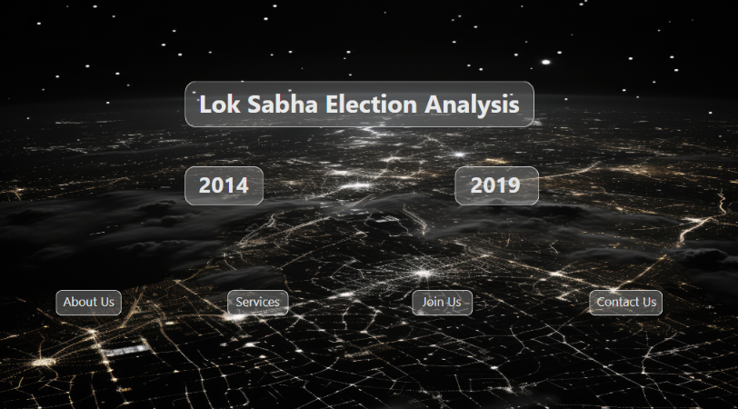

# 🇮🇳 Lok Sabha Election Analysis (2014 & 2019)

An interactive **Microsoft Power BI dashboard** for exploring and comparing India's Lok Sabha General Elections of 2014 and 2019.

## 📌 Project Overview

This project focuses on analyzing Indian General Election data for 2014 and 2019 using Microsoft Power BI.

The dashboard provides an interactive interface to explore election-related information and compare results across the two election years.

The objective is to transform election data into meaningful visual insights that make political trends and election performance easier to understand.

## 🎯 Project Objectives

- Analyze Lok Sabha election data for 2014 and 2019.
- Explore election results across different states.
- Understand party-wise election performance.
- Compare election outcomes between the two years.
- Present election information through interactive visualizations.
- Make complex election data easier to interpret.

## 🛠️ Tools & Technologies

| Tool | Purpose |
|---|---|
| Microsoft Power BI | Dashboard development |
| Power Query | Data transformation and cleaning |
| DAX | Calculations and analytical measures |
| Microsoft Excel | Data preparation and management |

## 📊 Dashboard Features

- Interactive home page and navigation.
- Separate navigation for the 2014 and 2019 elections.
- Election analysis through visual dashboards.
- Interactive report elements for exploring election information.
- User-friendly dashboard design.

## 🖥️ Dashboard Preview

Add your dashboard screenshots in the `Screenshots` folder.

### Home Page


### Election Analysis – 2014


### Election Analysis – 2019


*Replace these image paths with your actual screenshot filenames.*

## 📁 Project Structure

```text
Lok-Sabha-Election-Analysis/
│
├── election_analysis.pbix
│
├── Dataset/
│   └── election_data.csv
│
├── Screenshots/
│   ├── Home_Page.png
│   ├── Election_2014.png
│   └── Election_2019.png
│
└── README.md
```

*The Dataset and Screenshots folders should be added when those files are available.*

## 🚀 How to Run the Project

1. Clone or download this repository.
2. Install Microsoft Power BI Desktop.
3. Open `election_analysis.pbix`.
4. If prompted, update the dataset source path.
5. Refresh the data if required.
6. Explore the interactive dashboard.

## 📈 Key Findings

Add your actual findings after reviewing the dashboard, such as:

- Changes in party-wise seat distribution.
- State-wise election performance.
- Major differences between the 2014 and 2019 results.
- Important election trends and observations.

## 📚 Data Source

Add the original dataset source, publisher and dataset link here.

Please include the dataset's usage or redistribution licence where applicable.

## 👨‍💻 Author

**Harshit Rana**

B.Tech – Computer Science & Engineering

**Skills demonstrated:** Power BI | DAX | Power Query | Excel | Data Visualization

## 🔗 Project Repository

[Lok Sabha Election Analysis – GitHub](https://github.com/harshitrana2004/Lok-Sabha-Election-Analysis)

---

⭐ If you find this project useful, feel free to explore the repository and share your feedback.
